<div align="center">

<!-- International Collaboration Header -->
<table border="0" style="width: 100%; border-collapse: collapse; margin-bottom: 20px;">
  <tr style="border: none; background: transparent;">
    <td align="center" style="border: none; padding: 10px; width: 50%;">
      
      <br>
      <span style="font-size: 0.85em; color: #586069; font-weight: 500;">Vellore Institute of Technology (Chennai, India)</span>
    </td>
    <td align="center" style="border: none; padding: 10px; width: 50%;">
      
      <br>
      <span style="font-size: 0.85em; color: #586069; font-weight: 500;">Taylor's University (Subang Jaya, Malaysia)</span>
    </td>
  </tr>
</table>

# An Explainable Multimodal Data Fusion Framework for Compatibility Reasoning in Heterogeneous Decision Systems

### 🌾 **AgriCompatNet: Knowledge-Guided Machine Learning & Explainable Decision Support for Intercropping Systems**

[](https://doi.org/10.1016/j.array.2026.101267)
[](https://doi.org/10.1016/j.array.2026.101267)
[](LICENSE)
[](#-explainable-ai-xai--interpretability-suite)
[](#-experimental-benchmarks--validation)
[](#-international-collaboration--authors)
[](#-quick-start--reproduction)

<p align="center">
  <b>Published in Elsevier <i>Array</i> (Volume 32, Article 101267, 2026) — Special Issue on Explainable Decision Systems (EDS)</b>
  <br>
  <a href="https://doi.org/10.1016/j.array.2026.101267"><b>[Official ScienceDirect Article]</b></a> •
  <a href="resources/AgriCompatNet_Elsevier_Array_2026.pdf"><b>[Download Open-Access PDF]</b></a> •
  <a href="notebooks/agricompatnet_pipeline.ipynb"><b>[Executable Jupyter Notebook]</b></a> •
  <a href="#-citation"><b>[Cite This Work]</b></a>
</p>

---

</div>

> [!IMPORTANT]
> **Headline Empirical Findings:**
> **AgriCompatNet** achieves a state-of-the-art predictive performance of **$R^2 = 0.96$**, **$\text{RMSE} = 0.039$**, and **$\text{MAE} = 0.027$** across **~2.4 million crop-pair combinations** systematically generated from **2,200 curated crop instances** covering 7 core agro-environmental dimensions ($N, P, K$, temperature, humidity, pH, and precipitation). Furthermore, controlled sensitivity simulations under **$\pm 10\%$ environmental perturbations** confirm robust ecological stability without catastrophic phase transitions.

<div align="center">
  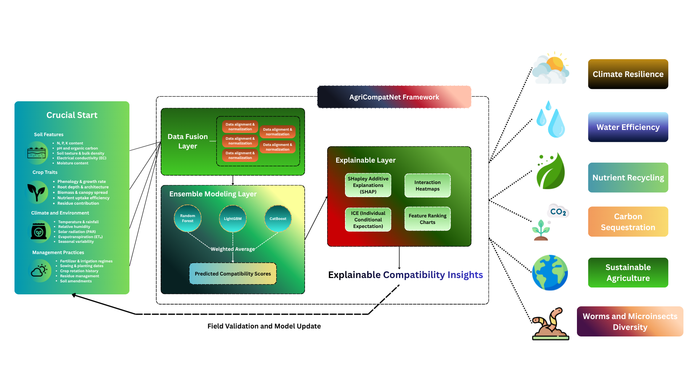
  <p><em>Figure 1: High-level architectural workflow of the AgriCompatNet framework, illustrating multimodal agro-environmental ingestion, domain-informed indicator construction, ensemble fusion, and post-hoc SHAP explainability.</em></p>
</div>

---

## 📑 Table of Contents

- [Overview & Core Motivation](#-overview--core-motivation)
- [International Collaboration & Authors](#-international-collaboration--authors)
- [Six-Stage Pipeline Architecture](#-six-stage-pipeline-architecture)
- [Mathematical Formulation & Agronomic Indicators](#-mathematical-formulation--agronomic-indicators)
- [Experimental Benchmarks & Validation](#-experimental-benchmarks--validation)
- [Explainable AI (XAI) & Interpretability Suite](#-explainable-ai-xai--interpretability-suite)
- [Visual Results & Empirical Gallery](#-visual-results--empirical-gallery)
- [Repository Structure](#-repository-structure)
- [Quick Start & Reproduction](#-quick-start--reproduction)
- [Citation](#-citation)
- [License & Open Access](#-license--open-access)

---

## 🌟 Overview & Core Motivation

Sustainable agriculture and agroecological intensification depend heavily on **intercropping**—cultivating two or more crop varieties simultaneously on the same parcel of land. While intercropping enhances biodiversity, curtails pest proliferation, optimizes soil microbiome health, and augments land equivalent ratio (LER), discovering mutually synergistic crop combinations across varied microclimates has traditionally relied on trial-and-error field trials or opaque, black-box recommendation models.

**AgriCompatNet** addresses this challenge through a **knowledge-guided multimodal data fusion framework**:
1. **Decoupling First-Order Heuristics from Emergent Interaction Modeling:** Rather than relying solely on deterministic formulas or unconstrained regression on raw sensor feeds, AgriCompatNet establishes an intermediate abstraction layer consisting of four domain-grounded agronomic indicators ($\text{NBI}$, $\text{ERS}$, $\text{NutComp}$, $\text{CP}$).
2. **Preventing Information & Target Leakage:** Strict partitioning and evaluation safeguards prevent formula memorization, allowing tree ensembles (Random Forest, LightGBM, CatBoost) to learn non-linear co-adaptation boundaries and ecological constraints.
3. **Intrinsic Explainable AI (XAI):** Full integration of Shapley Additive Explanations (SHAP), Partial Dependence Plots (PDP), Individual Conditional Expectation (ICE), and pairwise interaction analysis provides agronomic transparency for domain experts and farm decision-support systems (DSS).

---

## 🌐 International Collaboration & Authors

This scientific investigation was conducted under an international bilateral research collaboration between **Vellore Institute of Technology (VIT, India)** and **Taylor's University (Malaysia)**:

<table style="width: 100%; border-collapse: collapse;">
  <thead>
    <tr style="background-color: rgba(0, 115, 152, 0.08);">
      <th align="left">Author</th>
      <th align="left">Institutional Affiliation</th>
      <th align="left">Contact & Profiles</th>
    </tr>
  </thead>
  <tbody>
    <tr>
      <td><b>Gokul Ram K.</b></td>
      <td>School of Computer Science and Engineering, Vellore Institute of Technology, Chennai, India</td>
      <td><code>gokulram.k2023@vitstudent.ac.in</code></td>
    </tr>
    <tr>
      <td><b>Dr. U. Vignesh</b><br><i>(Corresponding Author)</i></td>
      <td>School of Computer Science and Engineering, Vellore Institute of Technology, Chennai, India</td>
      <td><a href="mailto:vignesh.u@vit.ac.in"><code>vignesh.u@vit.ac.in</code></a></td>
    </tr>
    <tr>
      <td><b>Dr. Geetha S.</b></td>
      <td>School of Computer Science and Engineering, Vellore Institute of Technology, Chennai, India</td>
      <td><code>geetha.s@vit.ac.in</code></td>
    </tr>
    <tr>
      <td><b>Dr. Parvathi R.</b></td>
      <td>Centre for Advanced Data Science, Vellore Institute of Technology, Chennai, India</td>
      <td><code>parvathi.r@vit.ac.in</code></td>
    </tr>
    <tr>
      <td><b>Assoc. Prof. Abdulkareem Sh. Mahdi Al-Obaidi</b></td>
      <td>School of Engineering, Faculty of Innovation and Technology, Taylor’s University, Subang Jaya, Malaysia</td>
      <td><code>abdulkareem.mahdi@taylors.edu.my</code></td>
    </tr>
  </tbody>
</table>

---

## 🏗️ Six-Stage Pipeline Architecture

The overall methodology formalized in **Algorithm 1** of the published paper is structured into six modular, interconnected stages:

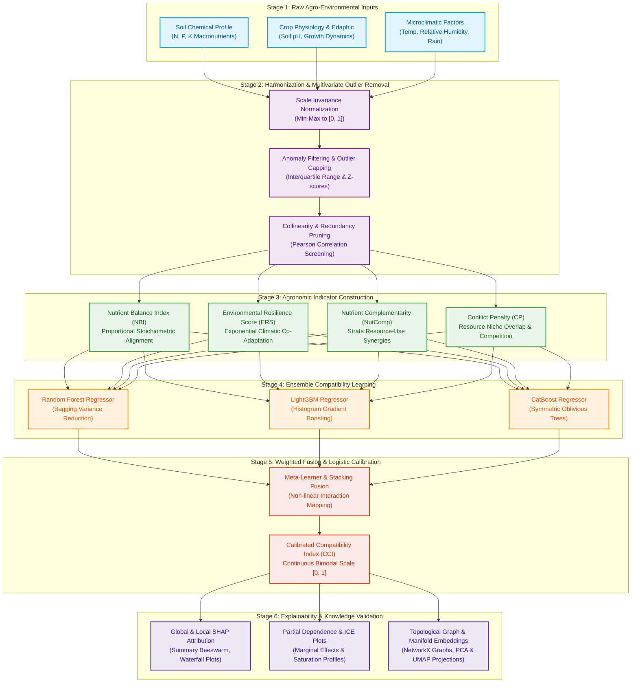

---

## 📐 Mathematical Formulation & Agronomic Indicators

AgriCompatNet constructs four domain-grounded composite indicators to model the biophysical and ecological interplay between crop pairs $a$ and $b$:

### 1. Nutrient Balance Index ($\text{NBI}$)
Quantifies how closely soil macronutrient proportions match agronomic optimal ratios, penalizing both deficiency and luxury consumption:

$$\text{NBI} = 1 - \frac{1}{m} \sum_{k=1}^{m} \left| \frac{r_k - r_k^{opt}}{r_k^{opt}} \right|$$

*Where $r_k$ represents the observed soil nutrient ratio (e.g., $N:P$, $N:K$, $P:K$), $r_k^{opt}$ is the empirically established optimal stoichiometric benchmark, and $m$ is the total number of evaluated nutrient pairs.*

### 2. Environmental Resilience Score ($\text{ERS}_{ab}$)
Measures climatic co-adaptation under shared temperature, relative humidity, and precipitation variability via an exponential decay formulation:

$$\text{ERS}_{ab} = \exp\left(-\frac{1}{n} \sum_{t=1}^{n} \frac{|E_{a,t} - E_{b,t}|}{\sigma_{E_t}}\right)$$

*Where $E_{a,t}$ and $E_{b,t}$ represent environmental tolerance requirements along dimension $t$, and $\sigma_{E_t}$ denotes the population-wide variance, ensuring multi-attribute scale invariance.*

### 3. Nutrient Complementarity ($\text{NutComp}_{ab}$)
Measures reciprocal resource-use partitioning, assessing whether one crop’s high demand is balanced by the partner crop’s modest requirement:

$$\text{NutComp}_{ab} = 1 - \frac{1}{K} \sum_{k=1}^{K} \left| U_{a,k} - (1 - U_{b,k}) \right|$$

*Where $U_{a,k}, U_{b,k} \in [0, 1]$ represent min-max normalized uptake intensities for macronutrient $k$ across the total evaluated nutrients $K$.*

### 4. Conflict Penalty ($\text{CP}_{ab}$)
Captures resource contention and ecological friction resulting from overlapping rhizosphere niches and divergent climatic regimes:

$$\text{CP}_{ab} = \frac{1}{2} \left( \sum_{k=1}^{K} w_k \frac{|U_{a,k} - U_{b,k}|}{\max(U_{a,k}, U_{b,k})} + \beta (1 - \rho(E_a, E_b)) \right)$$

*Where $w_k$ denotes the agronomic importance weight of nutrient $k$, $\rho(E_a, E_b)$ is the correlation coefficient across environmental responses, and $\beta$ balances edaphic vs climatic conflict.*

### 5. Unified Crop Compatibility Index ($\text{CCI}_{ab}$)
The final target metric combines these indicators into a unified score normalized to the unit interval $[0, 1]$:

$$\text{CCI}_{ab} = \alpha\,\text{NBI}_{ab} + \beta\,\text{ERS}_{ab} + \gamma\,\text{NutComp}_{ab} - \delta\,\text{CP}_{ab}$$

$$\text{subject to } \alpha + \beta + \gamma + \delta = 1, \quad \text{CCI}_{ab} \in [0, 1]$$

---

## 📊 Experimental Benchmarks & Validation

The framework was comprehensively benchmarked against standard decision models on a curated dataset of **2,200 crop instances** across **2.4 million generated crop-pair combinations**:

### Quantitative Benchmark Comparison (Table 1)

| Model Architecture | Model Paradigm | $R^2$ Score (Variance Explained) | RMSE (Root Mean Squared Error) | MAE (Mean Absolute Error) | Inference Characteristics |
| :--- | :--- | :---: | :---: | :---: | :--- |
| **Random Forest** | Bagging Ensemble | `0.91` | `0.049` | `0.031` | High variance control, tree diversity |
| **LightGBM** | Histogram Boosting | `0.93` | `0.045` | `0.029` | Fast gradient leaf-wise splitting |
| **CatBoost** | Symmetric Oblivious Trees | `0.90` | `0.051` | `0.033` | Strong regularization, categorical handling |
| **AgriCompatNet (Fusion)** | **Multimodal Knowledge-Guided Ensemble** | **`0.96`** | **`0.039`** | **`0.027`** | **State-of-the-art calibration & domain fidelity** |

> [!NOTE]
> **Ablation Insight:** Systematic feature exclusion confirms that removing the Conflict Penalty ($\text{CP}$) induces the steepest drop in predictive accuracy ($R^2$ drops from $0.96 \to 0.78$), verifying that antagonistic modeling is crucial for preventing false-positive recommendations.

---

### Top High-Synergy Compatible Crop Pairs (Table 2)

| Pair Rank | Crop A | Crop B | CCI Score | Agronomic Interaction Mechanism | Perturbation Stability ($\pm 10\%$) |
| :---: | :--- | :--- | :---: | :--- | :---: |
| `0` | Papaya | Papaya | `0.9975` | Homogeneous control baseline / self-affinity | High baseline stability |
| `1` | Mungbean | Mungbean | `0.9942` | Leguminous atmospheric nitrogen self-sufficiency | Extremely robust |
| `2` | Coconut | Coconut | `0.9925` | Deep vertical rooting system equilibrium | Resilient |
| **`4`** | **Mungbean** | **Blackgram** | **`0.9902`** | **Stratified root zones, complementary $N_2$-fixation, zero macronutrient competition** | **Stable ($\Delta\text{CCI} < 0.015$)** |
| **`7`** | **Rice** | **Jute** | **`0.9890`** | **Shared hydromorphic waterlogged niche, complementary vegetative canopy heights** | **Stable ($\Delta\text{CCI} < 0.018$)** |

---

## 🔬 Explainable AI (XAI) & Interpretability Suite

Interpretability in AgriCompatNet is treated as an active model-validation tool rather than an afterthought:

1. **Global SHAP Feature Importance:** Identifies Conflict Penalty ($\text{CP}$) as the primary determinant of compatibility variance, followed by Nutrient Complementarity ($\text{NutComp}$) and Nutrient Balance ($\text{NBI}$).
2. **Local SHAP Waterfall Explanations:** Deconstructs specific pairwise interactions (e.g., Mungbean–Blackgram) to reveal positive contributions from minimal edaphic friction.
3. **Partial Dependence & ICE Profiles:** Demonstrate monotonic, saturation-governed responses, proving that beyond threshold values of $\text{ERS}$, additional resilience yields diminishing returns.
4. **Second-Order Interaction Modeling:** Uncovers strong non-linear cross-talk between $\text{CP} \times \text{NBI}$, where favorable nutrient stoichiometry cannot overcome intense competitive conflict.

---

## 🖼️ Visual Results & Empirical Gallery

All figures extracted directly from the verified pipeline outputs:

<table border="0" style="width: 100%; border-collapse: collapse;">
  <tr>
    <td align="center" style="width: 50%; padding: 12px; vertical-align: top;">
      <a href="images/fig02_feature_normalization.png">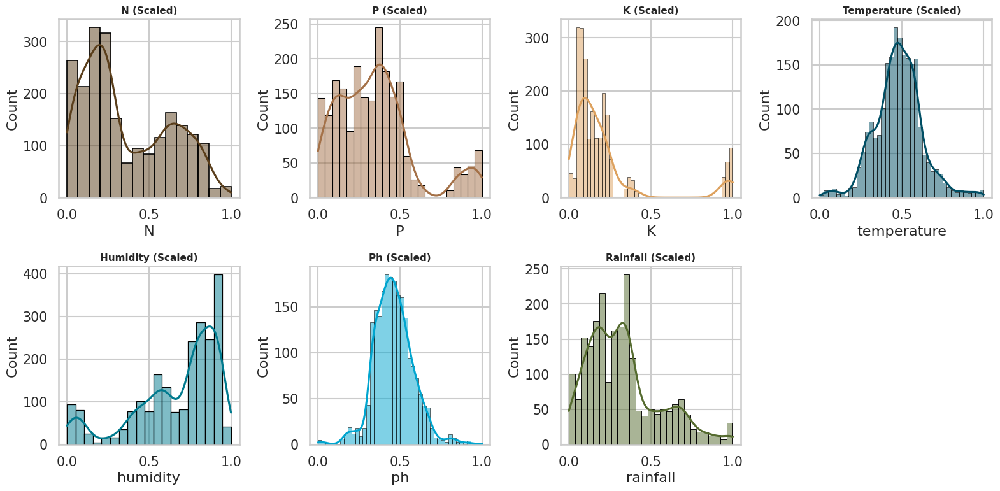</a>
      <br>
      <b>Fig 2: Feature Normalization Pipeline</b>
      <p style="font-size: 0.85em; color: #586069;">Min-Max scaling across 7 agro-environmental features ensuring equal variance contribution.</p>
    </td>
    <td align="center" style="width: 50%; padding: 12px; vertical-align: top;">
      <a href="images/fig03_outlier_detection_boxplots.png">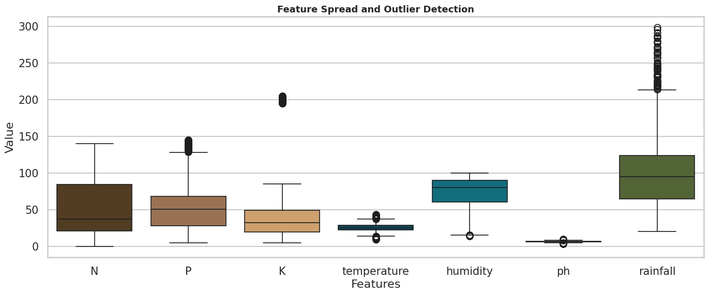</a>
      <br>
      <b>Fig 3: Multivariate Outlier Detection</b>
      <p style="font-size: 0.85em; color: #586069;">Interquartile range analysis identifying microclimatic and edaphic anomalies.</p>
    </td>
  </tr>
  <tr>
    <td align="center" style="width: 50%; padding: 12px; vertical-align: top;">
      <a href="images/fig05_cci_distribution.png">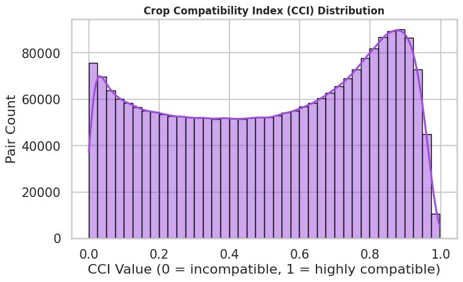</a>
      <br>
      <b>Fig 5: Bimodal CCI Distribution</b>
      <p style="font-size: 0.85em; color: #586069;">Clear separation between compatible ($CCI > 0.75$) and conflicting ($CCI < 0.35$) crop clusters.</p>
    </td>
    <td align="center" style="width: 50%; padding: 12px; vertical-align: top;">
      <a href="images/fig06_compatibility_heatmap.png">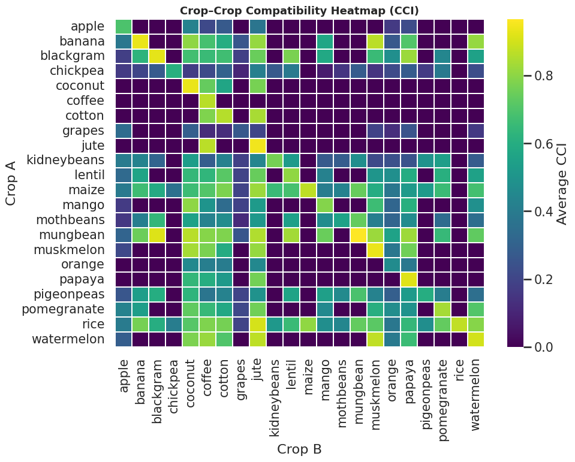</a>
      <br>
      <b>Fig 6: Pairwise Crop–Crop Heatmap</b>
      <p style="font-size: 0.85em; color: #586069;">Full $22 \times 22$ affinity matrix illustrating clustered guild synergies and competitive blocks.</p>
    </td>
  </tr>
  <tr>
    <td align="center" style="width: 50%; padding: 12px; vertical-align: top;">
      <a href="images/fig07_crop_compatibility_network.png">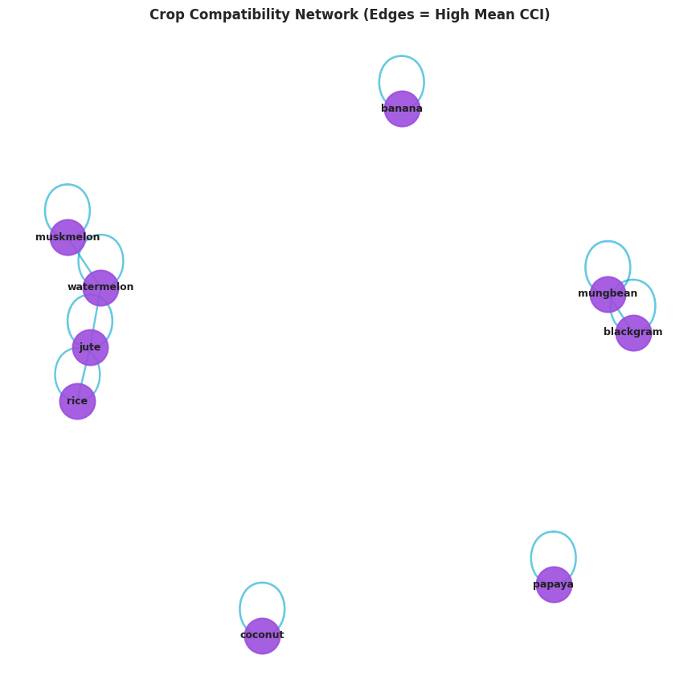</a>
      <br>
      <b>Fig 7: Compatibility Network Graph</b>
      <p style="font-size: 0.85em; color: #586069;">Topological network where edge thickness reflects high mutual compatibility ($CCI \ge 0.70$).</p>
    </td>
    <td align="center" style="width: 50%; padding: 12px; vertical-align: top;">
      <a href="images/fig12_pca_latent_clusters.png">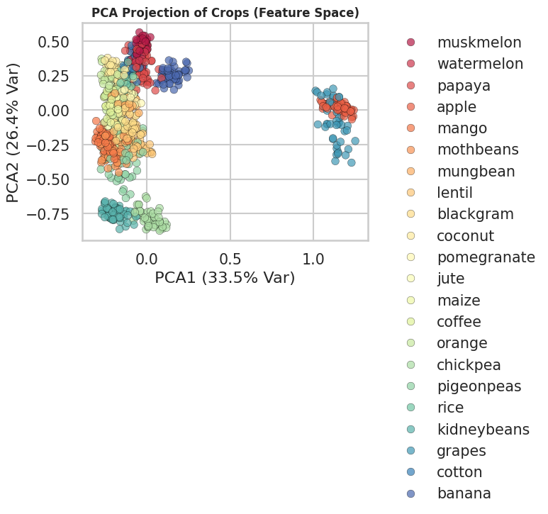</a>
      <br>
      <b>Fig 12: PCA Latent Space Embedding</b>
      <p style="font-size: 0.85em; color: #586069;">2D projection of agronomic indicator space showcasing distinct crop cluster formations.</p>
    </td>
  </tr>
  <tr>
    <td align="center" style="width: 50%; padding: 12px; vertical-align: top;">
      <a href="images/fig08_global_shap_importance.png">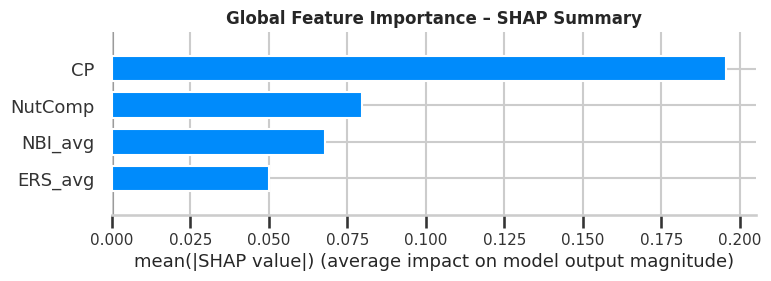</a>
      <br>
      <b>Fig 8: Global SHAP Feature Importance</b>
      <p style="font-size: 0.85em; color: #586069;">Conflict Penalty ($\text{CP}$) exhibits the highest mean absolute SHAP value.</p>
    </td>
    <td align="center" style="width: 50%; padding: 12px; vertical-align: top;">
      <a href="images/fig14_shap_beeswarm_impact.png">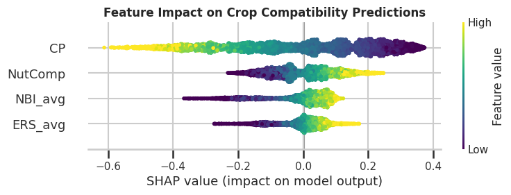</a>
      <br>
      <b>Fig 14: SHAP Summary Beeswarm Plot</b>
      <p style="font-size: 0.85em; color: #586069;">Feature value distribution demonstrating directional impact on compatibility prediction.</p>
    </td>
  </tr>
  <tr>
    <td align="center" style="width: 50%; padding: 12px; vertical-align: top;">
      <a href="images/fig09_partial_dependence_plots.png">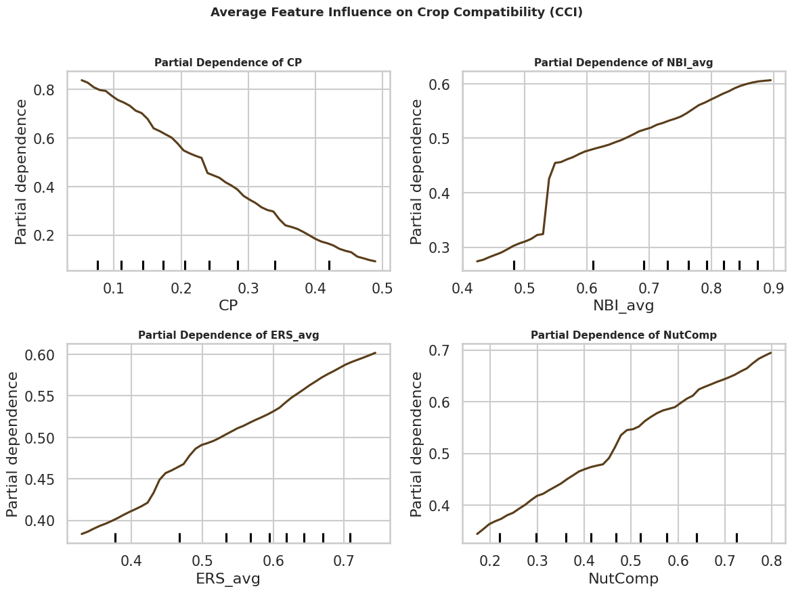</a>
      <br>
      <b>Fig 9: Partial Dependence Plots (PDP)</b>
      <p style="font-size: 0.85em; color: #586069;">Marginal effects of $\text{NBI}$, $\text{ERS}$, $\text{NutComp}$, and $\text{CP}$ on predicted $\text{CCI}$.</p>
    </td>
    <td align="center" style="width: 50%; padding: 12px; vertical-align: top;">
      <a href="images/fig11_shap_interaction_cp_nbi.png">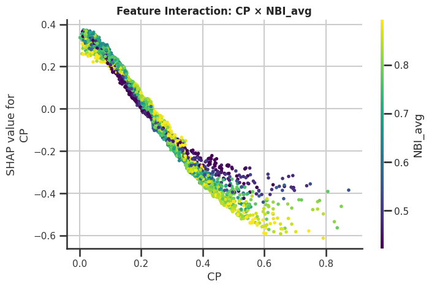</a>
      <br>
      <b>Fig 11: Feature Interaction (CP x NBI)</b>
      <p style="font-size: 0.85em; color: #586069;">Non-linear coupling proving high conflict suppresses favorable nutrient balance.</p>
    </td>
  </tr>
  <tr>
    <td align="center" style="width: 50%; padding: 12px; vertical-align: top;">
      <a href="images/fig04_environmental_sensitivity.png">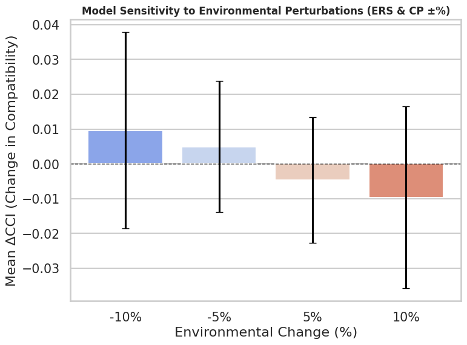</a>
      <br>
      <b>Fig 4: Environmental Perturbation Sensitivity</b>
      <p style="font-size: 0.85em; color: #586069;">Controlled $\pm 10\%$ perturbations of $\text{ERS}$ and $\text{CP}$ illustrating model resilience.</p>
    </td>
    <td align="center" style="width: 50%; padding: 12px; vertical-align: top;">
      <a href="images/ice_individual_conditional_expectation.png">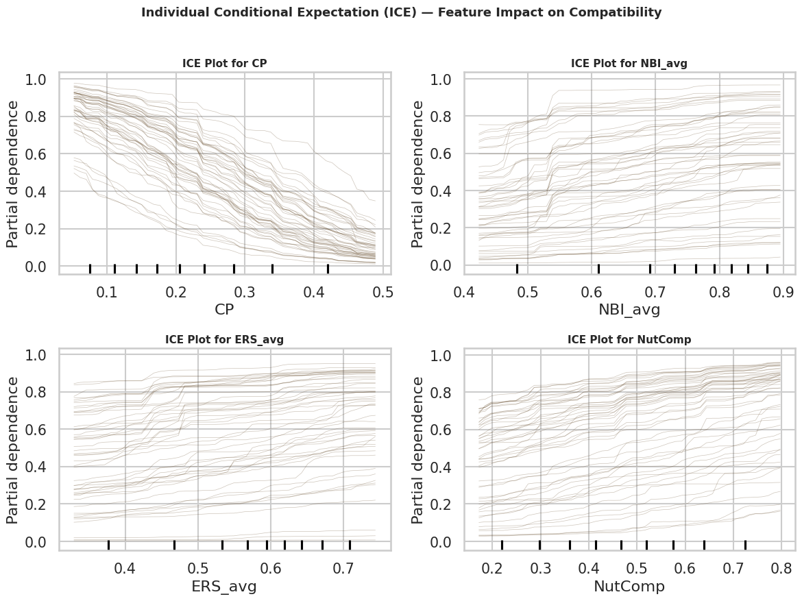</a>
      <br>
      <b>ICE: Individual Conditional Expectation Curves</b>
      <p style="font-size: 0.85em; color: #586069;">Observation-level trajectory validation confirming homogeneous monotonic slopes.</p>
    </td>
  </tr>
</table>

---

## 📂 Repository Structure

```text
AgriCompatNet/
├── .gitignore                      # Python, Jupyter, virtualenv exclusions
├── CITATION.cff                    # Citation File Format (v1.2.0) metadata
├── LICENSE                         # Dual License: MIT (Code) & CC BY 4.0 (Assets)
├── README.md                       # Comprehensive repository documentation
├── requirements.txt                # Pinned dependency requirements
├── images/
│   ├── 1_Graphical_Insights.png    # High-resolution framework architecture diagram
│   ├── badges/                     # Crisp local SVG status badges
│   │   ├── badge_elsevier_array.svg
│   │   ├── badge_doi.svg
│   │   ├── badge_license.svg
│   │   ├── badge_xai.svg
│   │   ├── badge_benchmark.svg
│   │   ├── badge_collaboration.svg
│   │   └── badge_python.svg
│   ├── logos/                      # Institutional logos
│   │   ├── vit_chennai_logo.png
│   │   └── taylors_university_logo.png
│   ├── fig02_feature_normalization.png
│   ├── fig03_outlier_detection_boxplots.png
│   ├── fig04_environmental_sensitivity.png
│   ├── fig05_cci_distribution.png
│   ├── fig06_compatibility_heatmap.png
│   ├── fig07_crop_compatibility_network.png
│   ├── fig08_global_shap_importance.png
│   ├── fig09_partial_dependence_plots.png
│   ├── fig10_local_shap_waterfall_pair1.png
│   ├── fig11_shap_interaction_cp_nbi.png
│   ├── fig12_pca_latent_clusters.png
│   ├── fig13_feature_correlation_matrix.png
│   ├── fig14_shap_beeswarm_impact.png
│   └── ice_individual_conditional_expectation.png
├── notebooks/
│   └── agricompatnet_pipeline.ipynb # Complete 39-cell end-to-end research notebook
└── resources/
    └── AgriCompatNet_Elsevier_Array_2026.pdf # Full Elsevier published open-access paper
```

---

## 🚀 Quick Start & Reproduction

### 1. Clone the Repository
```bash
git clone https://github.com/GOKULRAM-K/AgriCompatNet.git
cd AgriCompatNet
```

### 2. Set Up a Virtual Environment (Python 3.10+)
```bash
python -m venv venv

# On Linux/macOS:
source venv/bin/activate

# On Windows:
venv\Scripts\activate
```

### 3. Install Dependencies
```bash
pip install --upgrade pip
pip install -r requirements.txt
```

### 4. Run the Research Notebook
Launch the Jupyter Notebook to reproduce all 6 stages, figures, and benchmark metrics:
```bash
jupyter notebook notebooks/agricompatnet_pipeline.ipynb
```

---

## 📜 Citation

If you use **AgriCompatNet**, its algorithmic indicators ($\text{NBI}$, $\text{ERS}$, $\text{NutComp}$, $\text{CP}$, $\text{CCI}$), or baseline comparisons in your research, please cite our published paper in **Elsevier *Array***:

<details open>
<summary><b>BibTeX Format (Click to Expand / Collapse)</b></summary>

```bibtex
@article{GOKULRAM2026101267,
  title = {An explainable multimodal data fusion framework for compatibility reasoning in heterogeneous decision systems},
  journal = {Array},
  volume = {32},
  pages = {101267},
  year = {2026},
  issn = {2590-0056},
  doi = {10.1016/j.array.2026.101267},
  url = {https://doi.org/10.1016/j.array.2026.101267},
  author = {Gokul Ram K. and U. Vignesh and Geetha S. and Parvathi R. and Abdulkareem Sh. Mahdi Al-Obaidi},
  keywords = {Explainable artificial intelligence, Multimodal data fusion, Decision support systems, Crop compatibility, Ensemble learning, Precision agriculture},
  note = {Special Issue: EDS}
}
```
</details>

<details>
<summary><b>APA 7th Edition Format</b></summary>

> Gokul Ram, K., Vignesh, U., Geetha, S., Parvathi, R., & Al-Obaidi, A. S. M. (2026). An explainable multimodal data fusion framework for compatibility reasoning in heterogeneous decision systems. *Array*, 32, Article 101267. https://doi.org/10.1016/j.array.2026.101267
</details>

---

## ⚖️ License & Open Access

- **Software & Notebook Code:** Released under the permissive **[MIT License](LICENSE)**.
- **Research Assets, Figures, & Indicators:** Published open-access by Elsevier Inc. under the **[Creative Commons Attribution 4.0 International (CC BY 4.0)](https://creativecommons.org/licenses/by/4.0/)** license.
- **Corresponding Inquiries:** Dr. U. Vignesh (`vignesh.u@vit.ac.in`) & Gokul Ram K. (`gokulram.k2023@vitstudent.ac.in`).

<div align="center">
  <sub>Developed with passion for open science, sustainable agriculture, and explainable artificial intelligence.</sub>
</div>
